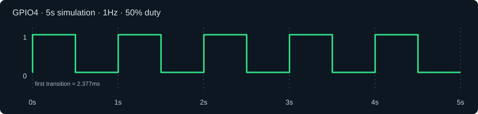

# 第 01 课：GPIO4 闪烁与模拟器调试

**状态：已通过 esp32sim 验证。** 源码：[`source/gpio-blink-rust`](../../source/gpio-blink-rust/)。

## 学习目标

1. 搭建 macOS 的 ESP32-S3 Xtensa Rust 工具链。
2. 理解 `#![no_std]`、`#![no_main]`、`esp_hal::init`、GPIO Output 与轮询延时。
3. 产出 ELF、espflash BIN；区分静态镜像检查与运行验证。
4. 使用 esp32sim 加载 ROM、模拟执行、输出 VCD，利用波形验证行为。
5. 掌握按“症状 → 证据 → 根因 → 最小修复 → 复验”排错。
6. 区分 GPIO 波形、固件串口输出和模拟器运行日志；利用 VCD 回放虚拟 LED，理解模拟器板卡模型的边界。

## 源码与工作原理

该项目使用 `esp-hal ~1.2.2`，目标 `xtensa-esp32s3-none-elf`，设置最大 CPU 时钟，将 GPIO4 设为输出、初始低电平，循环调用 `led.toggle()`，再用 `Instant::now()` 忙等待 500 ms。

关键代码（节选；**以仓库源码为准**）：

```rust
let config = esp_hal::Config::default().with_cpu_clock(CpuClock::max());
let peripherals = esp_hal::init(config);
let mut led = Output::new(
    peripherals.GPIO4,
    Level::Low,
    OutputConfig::default(),
);
loop {
    led.toggle();
    let delay_start = Instant::now();
    while delay_start.elapsed() < Duration::from_millis(500) {}
}
```

忙等待适合第一课验证时钟与 GPIO，但会持续占用 CPU。第 03 课再研究非阻塞定时。

## 从源码到镜像

```bash
cd source/gpio-blink-rust
cargo +esp build --release
ELF=target/xtensa-esp32s3-none-elf/release/gpio-blink-rust
espflash save-image --chip esp32s3 "$ELF" "$ELF.bin"
esptool --chip esp32s3 image-info "$ELF.bin"
```

记录：ELF 入口 `0x40378620`，BIN 约 78 KB。镜像包含 DROM/DRAM/IRAM、零地址 PADDING 和 IROM 段。`image-info` 能检查镜像结构，不能证明模拟器兼容。

## 运行模拟器

需使用**已处理零地址 PADDING 的 esp32sim** 和已下载的 ESP32-S3 ROM。示例从模拟器仓库根目录运行：

```bash
COURSE=/absolute/path/to/esp32-course
APP="$COURSE/source/gpio-blink-rust/target/xtensa-esp32s3-none-elf/release/gpio-blink-rust"
./target/release/esp32sim \
  --chip s3 --board none --boot app \
  --app "$APP.bin" --elf "$APP" \
  --rom roms/esp32s3_rev0_rom.elf \
  --max-seconds 5 --vcd gpio.vcd
```

不要把 `--stop-after-exceptions 1` 用作最终验收：正常的 Xtensa Window Overflow 异常也可能触发该停止条件。排障时才用 `--trace` 和异常停止限制。

## 完整排障复盘

| 阶段 | 现象 | 证据与定位 | 处理 |
| --- | --- | --- | --- |
| 镜像加载 | `load: address 0x00000000 not mapped` | BIN 含 `load_addr=0` 的 PADDING 段；模拟器将其当 RAM 加载 | 在 `esp32s3/src/soc.rs` 的 `boot_app` 循环跳过该 padding；整理上游 PR |
| ROM 缺失 | `ill` 于 `0x400003c0` | 固件调用了 ROM 区域的函数，但未提供 ROM ELF | 下载校验 ROM 并用 `--rom` 指定 |
| 下载脚本 | macOS `mkdir: illegal option -- -` | 需要使用 `sh -x` 确认具体执行参数；不要简单推断是 BSD `mkdir` 本身不能运行 `mkdir -p` | 检查目录参数和脚本执行环境；最终成功生成 ROM |
| 首次 ROM 启动 | `cause 513`，`_WindowOverflow4` | 反汇编见 `s32e` 和 `rfwo`；属于 Xtensa 寄存器窗口处理路径 | 去掉 `--stop-after-exceptions 1`，继续执行 |
| 最终运行 | 模拟 5.000 秒，约 12 亿指令、3 次异常、VCD 10 个事件 | CPU 持续运行，波形显示 GPIO4 每 500 ms 翻转 | 验收通过 |

注意：此前对于 `mkdir` 报错的根因**未由跟踪日志最终证实**，不把推测写成确定事实。3 次异常不等于有 3 个未恢复故障，异常类型仍应结合 trace 分析。

## 用实际 VCD 验收

```text
$timescale 1ps $end
$var wire 1 s4 gpio4 $end
#0
xs4
#2377333333
1s4
#502377333333
0s4
#1002377333333
1s4
```

1ps 为时间刻度，因此高电平第一次从 2.377333333ms 到 502.377333333ms，持续 **500ms**；之后每隔 500ms 翻转。完整周期 1s，即 **1Hz**。初始为 `x`（未知电平）后开始输出高低交替。

### 在 VS Code 中查看 GPIO4 波形（已实测）

本次实践先试用了 **WaveTrace**：打开原始 `gpio.vcd` 时，一次视图只出现不符合预期的绿色区段；将时间轴调整为 0～5s 后又出现空白。曾怀疑是 `1ps` 时间单位或较大时间戳导致的兼容性问题，**但未通过独立复现确认具体原因，因此不能将该猜测当作确定根因**。

随后改用 **Surfer Waveform Viewer**，**直接打开同一个原始 `gpio.vcd` 文件，无需转换时间单位**，在 0～5s 的视图中正确显示了方波。这是第一课最终采用的图形化验收方式。

操作步骤：

1. 在 VS Code 扩展市场安装 Surfer Waveform Viewer。
2. 打开 `source/gpio-blink-rust/gpio.vcd`。若文件被其他扩展接管，使用 **Reopen Editor With...** 选择 Surfer。
3. 左侧 `Scopes` 选择 `esp32sim`，在 `Variables` 中添加 `gpio4`（或确认它已在信号列表）。
4. 使用 Fit/Zoom Fit 让时间轴显示 0～5s，观察高低电平以 500ms 的间隔交替。
5. Surfer 截图顶部可以显示以 `ps` 为单位的刻度，如 `1000000000000 ps`；它等于 `1s`，并非时间解析错误。



> 上图是根据提交的 VCD 事件数据重新绘制的示意图，**不是 Surfer 原始截图**。实际 Surfer 截图已在本次课程实践中人工核对：波形为 500ms 高电平、500ms 低电平的连续方波。若需要将截图也纳入仓库，可另保存为 `book/src/images/lesson-01-gpio4-surfer.png` 并在此加入图片引用。

### 实践结论

- 原始 VCD 文件有效，Surfer 能直接正常显示；无需使用 `convert_vcd.py`。
- 高电平首次开始于 **2.377333333ms**；之后相邻电平切换精确相隔 **500ms**（以原始 VCD 计）。
- 整体占空比接近 **50%**，完整周期 **1s**，频率 **1Hz**。
- 当不同波形查看器显示不一致时，以原始 VCD 的 `$timescale`、时间戳及其他查看器交叉核对，先排除渲染问题，不要立即修改固件或模拟器。

## 从 GPIO 方波到真实 LED

第一课的代码每隔 500ms 调用一次 `led.toggle()`，因此 GPIO4 每半秒翻转一次电平：高电平 500ms、低电平 500ms，完整周期 **1s（1Hz）**。如果真实开发板将一颗**高电平点亮的普通 LED** 经合适的限流电阻连接到 GPIO4 和 GND，且引脚功能、供电和接线正确，那么可以观察到 **亮 500ms、灭 500ms** 的循环。若 LED 是低电平点亮，亮灭阶段相反，周期不变。

> 这仍只是模拟器验收的外推，尚未在真实开发板验证。部分 ESP32-S3 开发板的板载 LED 并非连接 GPIO4，或使用 WS2812 等可寻址 RGB LED，不能直接用普通 GPIO 电平驱动；务必先检查具体开发板原理图。不要将 LED 不限流地直接接在 GPIO 上。

## 不同观察方式：VCD、串口和模拟器日志

| 类型 | 数据来源 | 第一课的实际表现 | 作用 |
| --- | --- | --- | --- |
| GPIO VCD | 模拟器捕获引脚电平事件与时间戳 | `gpio.vcd` 中有 10 个 `gpio4` 变化事件 | 精确核对时序、电平、频率、占空比 |
| 串口监视器（UART） | **固件主动通过 UART 输出的字节** | 第一课示例**没有**主动打印 GPIO 状态 | 显示固件日志、调试文本或通信协议 |
| 模拟器运行日志 | 模拟器自身运行状态和 CPU 信息 | `[emu] stop: Halted`、`[vcd] wrote 10 events` 等 | 检查启动、运行时长、异常及外设汇总 |
| 板卡可视化 / 回放 | 板卡模型或外部工具对状态的呈现 | 本课可借助 VCD 生成 LED 回放动画 | 直观看亮灭，方便教学演示 |
| 真实硬件 | GPIO 电路、LED、逻辑分析仪 | 尚未验证 | 验证实际电气行为 |

**重要区别**：VCD 不是 UART 串口监听输出；`[emu]` 日志也不是 Rust 固件通过串口打印。波形告诉我们“引脚实际上如何变化”，串口信息告诉我们“程序主动报告了什么”，两者应交叉验证而非混为一谈。

## 可视化演示：把 VCD 回放成 LED 亮灭

当前调用 `--board none`，代表裸 ESP32-S3，没有附加任何显示灯或按钮模型。因此 **不会自动显示一颗正在闪烁的 LED**。只把参数改为 `--board atech14` 也不能直接完成此事：v0.3.0 的 Atech 板卡具有由 GPIO8/RMT 控制的 WS2812 LED 环，而不是一颗直接接在 GPIO4 的普通 LED（参见 [esp32sim 板卡文档](https://github.com/mikroverk/esp32sim/blob/v0.3.0/docs/boards.md)）。

本课程新增一个**纯本地 HTML 虚拟 LED 查看器**：

[`source/gpio-blink-rust/tools/led-vcd-viewer.html`](https://github.com/kyf/esp32-course/blob/docs/mdbook-lessons-01-02/source/gpio-blink-rust/tools/led-vcd-viewer.html)

它可读取原始 `gpio.vcd` 的 `$timescale` 和 GPIO4 事件，然后按时间戳播放。使用方法：

1. 从仓库打开或下载 `source/gpio-blink-rust/tools/led-vcd-viewer.html`，在 macOS 中用浏览器打开（也可双击本地 HTML 文件）。
2. 点击“选择 VCD 文件”，加载 `source/gpio-blink-rust/gpio.vcd`。
3. 点击“播放”；观察虚拟 LED **每 500ms 亮/灭交替**。
4. 用进度条暂停或跳转，也可以调整 0.5×、1×、2×、5× 播放速度。
5. 绿色灯亮对应 GPIO4 高电平；灰色灯灭对应低电平。本示意默认高电平点亮。

本查看器只读取用户选择的本地 VCD 文件，不需要后端服务或真实开发板。**它展示的是“固件模拟后生成的波形回放”，不是 ESP32-S3 固件运行时实时驱动的虚拟 LED。** 当前回放可复现，但尚未记录本机浏览器的实际播放验收截图。

### 如果要在模拟器中实时看到 LED

需要为 esp32sim 新增或改造一个板卡模型，让其接收 GPIO4 输出事件并更新 LED 状态，再由相应前端展示。v0.3.0 的 `BoardModel` 接口具有 `gpio_output_at`（捕获引脚电平变化）和 `leds()`（提供 LED 状态）等能力；但是**本课程尚未实现这种实时虚拟板卡**。

后续可以创建一个教学专用的 `course-board`：GPIO4 为可视化 LED，GPIO5 为可点击按钮，并在第二课验证 GPIO5 输入驱动 GPIO4 输出。这个项目属于模拟器开发扩展，不应误认为已由当前 `--board none` 支持。

## 验收

- [x] 固件生成 ELF/BIN。
- [x] ROM 成功加载；固件从 `Reset` 进入执行。
- [x] esp32sim 执行至 `--max-seconds 5`。
- [x] VCD 包含 `gpio4` 且每 500ms 翻转。
- [x] Surfer 直接显示原始 VCD 的 0～5s 方波；已核对截图。
- [x] 将 GPIO VCD、固件 UART 输出、模拟器日志分别定义并区分。
- [x] 提供读取原始 VCD 的离线 HTML 虚拟 LED 回放工具（代码已提交）。
- [ ] 本地浏览器手动验收 HTML 回放界面并留存截图。
- [ ] 模拟器实时可视化板卡（未实现）。
- [ ] 真实 ESP32-S3 开发板验证（未完成）。

## 课后思考

为什么镜像的 PADDING 不应加载到地址 0？为什么不能见到一次 Xtensa Window Overflow 就判定程序崩溃？为什么忙等待在下一阶段需要替换？为什么 VCD 数据和串口日志不同？为什么波形回放不等于模拟器实时连接的虚拟 LED？
